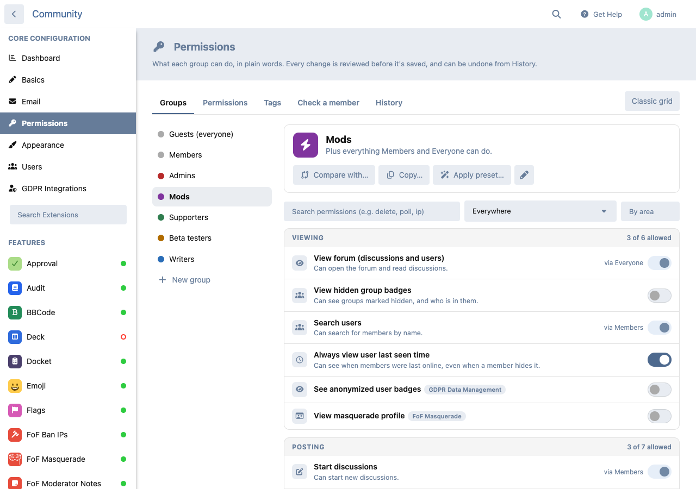
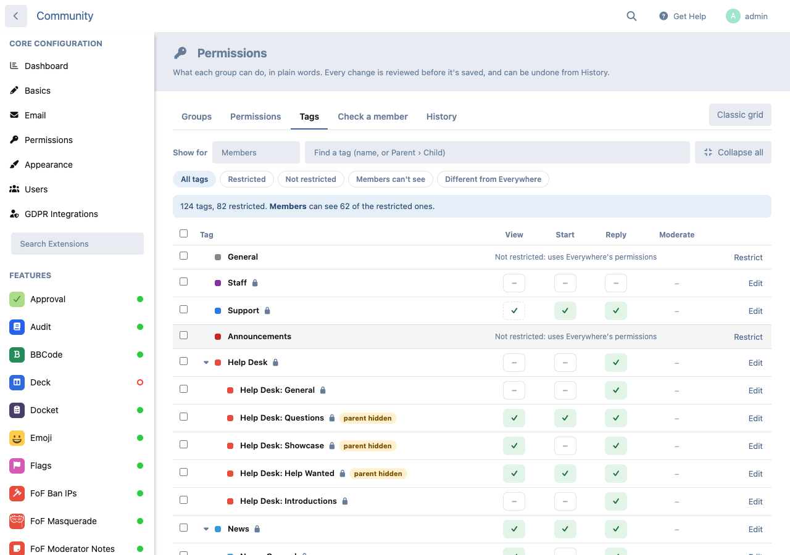
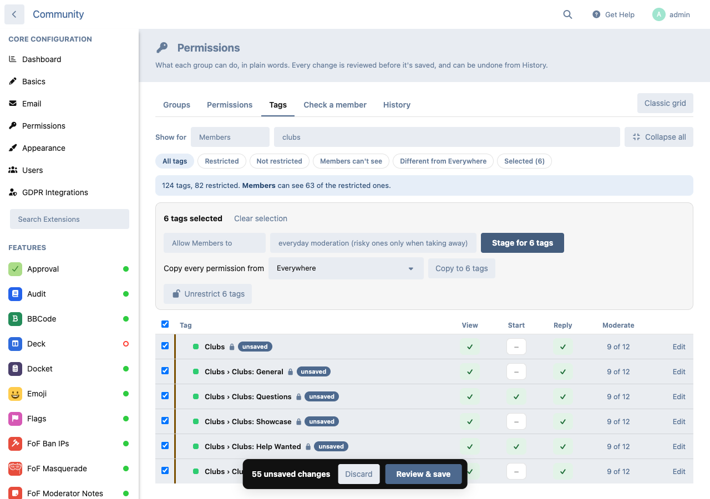
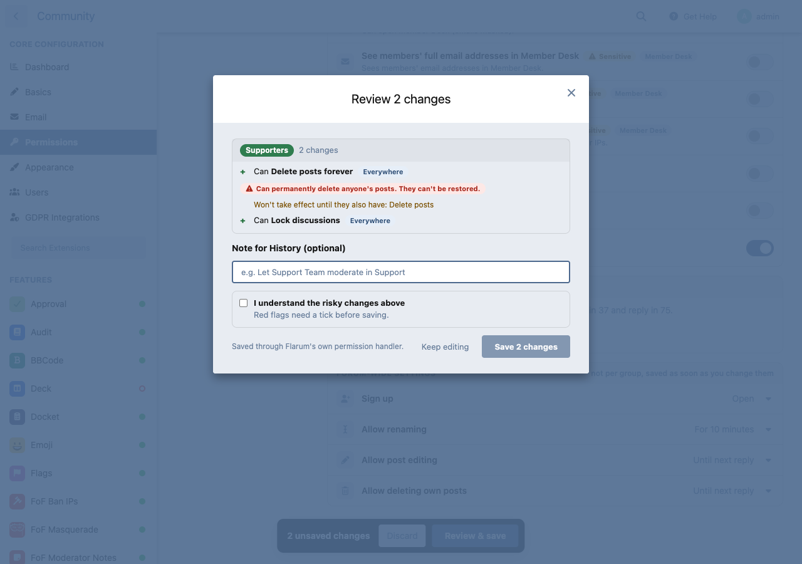
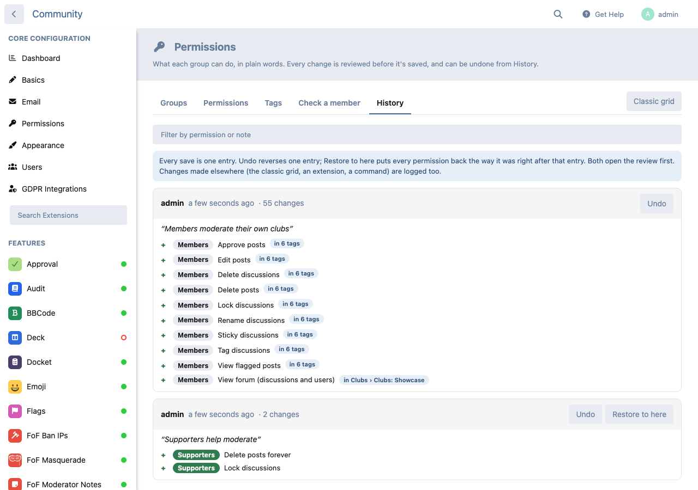
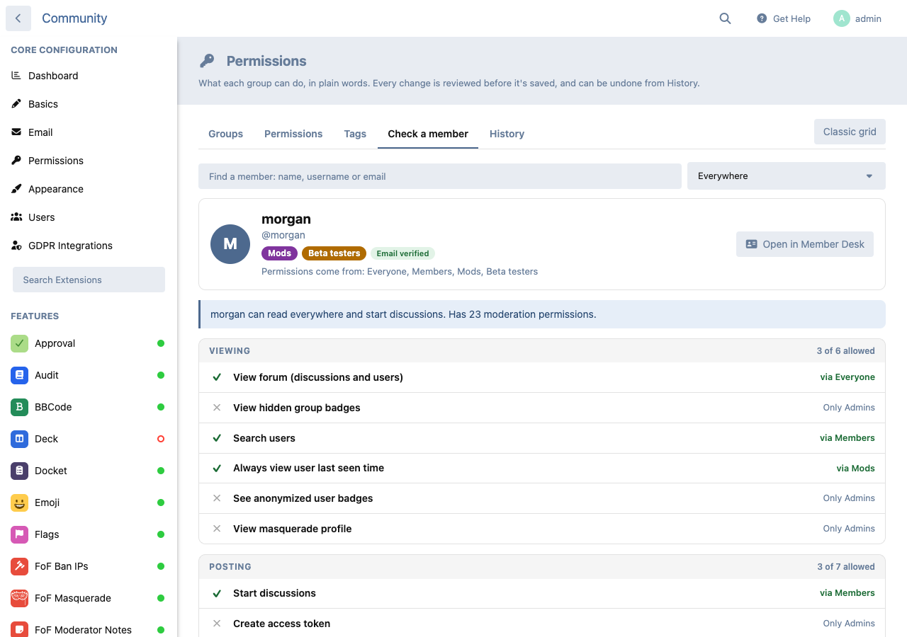
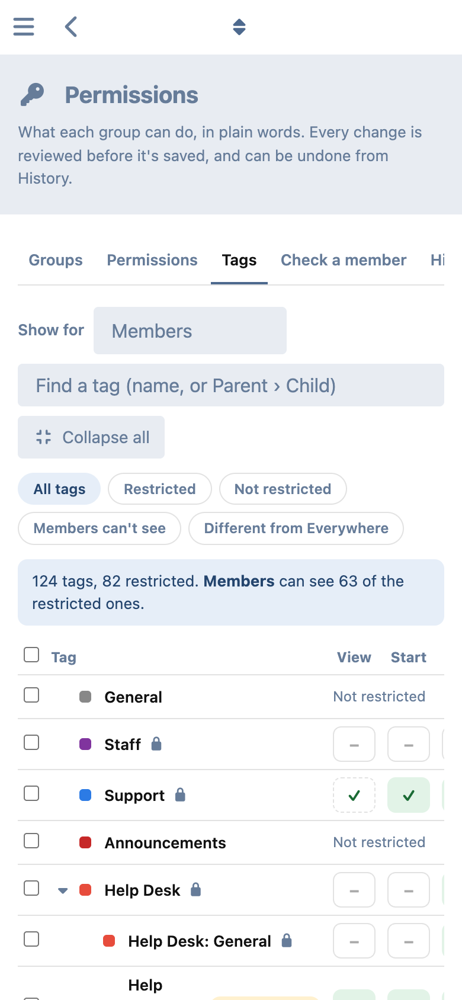
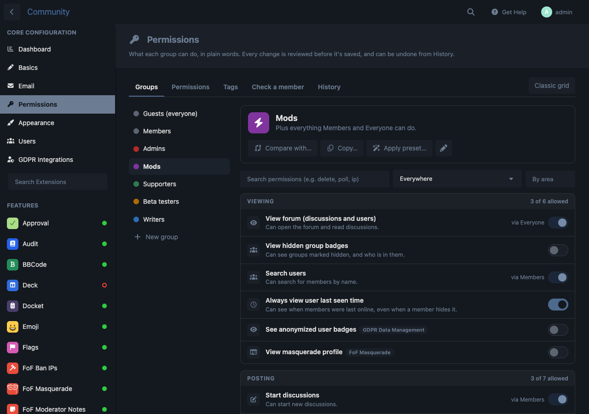

# Permission Desk

A replacement for Flarum 2's admin Permissions page. Instead of one huge grid of icons, you pick a group and read what
it can do in plain words, change it with switches, and review every change before it's saved. Every save can be undone
from History. It's built for forums with a lot of tags: 100, 200, more.



## What it does

- **Groups.** Pick a group and see everything it can do, sorted by area (viewing, posting, replying, moderation…) or by
  extension, Everywhere or inside one restricted tag. Each permission says what it means ("Can permanently delete
  anyone's posts") and where it comes from ("via Members"). Search finds a permission by name.
- **Permissions.** Every permission and who has it, with filters: what everyone can do, what one group can do, admin
  only, risky ones, and permissions left over from extensions that are no longer installed.
- **Tags.** Every tag in your forum's tree (children under their parents, collapsible), with View, Start and Reply for
  one group as buttons you click. Search by name or by "Parent › Child", filter to restricted tags, open tags, tags a
  group can't see, or tags that differ from Everywhere. A warning shows when a child tag's parent is hidden from the
  group, because the child is then hidden too.
- **Bulk changes across tags.** Select tags and allow or take away view, start, reply or everyday moderation for a
  group, copy every permission from another tag, or restrict and unrestrict them. Restricting first copies Everywhere's
  permissions into the tag, so nobody gains or loses anything the moment you do it.
- **Check a member.** Type a name and see what that one member can do and why: which group gives it, or why not.
  Unconfirmed email and suspensions are shown the way Flarum treats them (as a guest).
- **Review before saving.** Changes are staged, never saved on a click. The review lists them in plain words, flags the
  risky ones in red (those need a tick), and says when a permission won't work without another ("Also needs: Delete
  posts", with a button to add it). Add a note for History if you like.
- **History, undo and restore.** Every save is one entry with who, when and the note. Undo reverses one entry; Restore
  to here puts every permission back the way it was right after it. Both open the review first. Rows changed since are
  skipped, never overwritten. Changes made elsewhere (the classic grid, an extension's install, a command) are found by a
  nightly check and logged too.
- **Compare, copy and presets.** Compare two groups side by side, copy one group's permissions to another, and apply a
  preset: Read only, Member (Flarum's default), Trusted member, Moderator or Tag moderator. Save any group as your own
  preset.
- **The classic grid** is one click away, for anyone who wants it.











## Built for a lot of tags

The Tags tab shows every tag for one group on one screen, with search and filters, so 100+ tags stay manageable.
Everywhere else a searchable tag picker replaces the long dropdowns, an opened permission
lists only the tags where it differs from Everywhere (with a button to make them all match), and the review and History
fold the same change across many tags into one line ("in 6 tags", opening to their names).

## Safe by design

- It writes only Flarum's own `group_permission` table, and only through Flarum's own permission handler, once per
  permission, inside one transaction. Nothing is half saved.
- If someone else changed one of the same permissions while you were editing, the whole save is refused, so nothing
  is overwritten.
- Admin only. With [flarum/audit](https://github.com/flarum/audit) installed, every change is also in the audit log.



It works on phones and in dark mode.



## Works with

- [flarum/tags](https://github.com/flarum/framework/tree/2.x/extensions/tags): the Tags tab and per-tag permissions.
- [flarum/audit](https://github.com/flarum/audit): every change in the audit log too.
- [flarum/suspend](https://github.com/flarum/framework/tree/2.x/extensions/suspend): suspended members are shown as
  guests in Check a member.
- [Member Desk](https://github.com/ernestdefoe/member-desk): a Permissions button on each member's page.

All optional.

## Install

```sh
composer require ernestdefoe/permission-desk
php flarum migrate
php flarum cache:clear
```

Then enable it in the admin. The Permissions page opens Permission Desk. Run Flarum's scheduler
(`php flarum schedule:run` every minute from cron) so changes made outside Permission Desk are logged nightly; History
also checks whenever it's opened and before every save.

## Update

```sh
composer update ernestdefoe/permission-desk
php flarum migrate
php flarum cache:clear
```

## Links

- [Packagist](https://packagist.org/packages/ernestdefoe/permission-desk)

MIT licensed. ☕ If you like the things I have built, consider [buying me a coffee](https://buymeacoffee.com/ernestdefoe).
